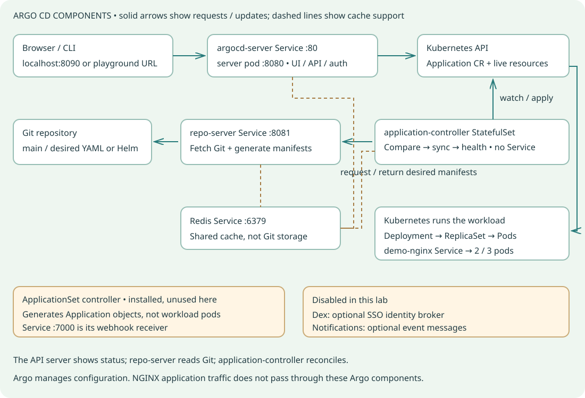

# Argo CD components and Services

Use this after installing Argo CD in Lab 2. It describes the pinned lab chart, not every possible production configuration.



## Component roles

### argocd-server (Deployment)

The front desk: serves the browser UI and CLI/API, authenticates users, enforces Argo RBAC, and accepts management requests.

Needed for our UI/CLI lesson. Auto-reconciliation is performed by the application-controller.

### argocd-repo-server (Deployment)

The Git reader and renderer: fetches the selected revision and returns desired Kubernetes manifests. It reads raw YAML here; it renders Helm charts in the optional exercise.

Needed to obtain desired manifests. It does not apply the workload to the cluster.

### argocd-application-controller (StatefulSet)

The reconciler: watches Application objects and live resources, compares desired/live state, applies sync operations, and evaluates resource health.

Needed for sync and self-healing. In this chart it is a StatefulSet with a stable pod name; that does not imply a data PVC exists.

### argocd-redis (Deployment)

The shared cache: speeds access to generated manifests and application/cluster state.

Present in this installation. Git and Kubernetes API objects remain the durable desired/configuration sources; Redis is not your Git repository.

### argocd-applicationset-controller (Deployment)

The Application generator: creates or updates Application objects from an ApplicationSet template and generator.

Installed by this chart but unused by our one-Application demo. It does not directly replace the application-controller or deploy pods.

### argocd-dex-server (Disabled in our values)

An optional identity broker for configured single sign-on integrations. Some deployments use a direct OIDC provider instead.

Not needed for this lab: admin login is handled by argocd-server.

### argocd-notifications-controller (Disabled in our values)

An optional notifier: sends configured messages when Application events meet configured triggers.

Not needed for deployment or self-healing. No alert destination is configured here.

## Services observed in the live lab

| Service | Service → pod port | Purpose |
|---|---|---|
| argocd-server | 80 and 443 → pod 8080 | Browser and CLI/API access. Our helper maps localhost:8090 to Service port 80. Both Service ports target 8080 in this chart; server.insecure=true makes this lab HTTP even though one port is named https. |
| argocd-repo-server | 8081 → pod 8081 | Internal gRPC endpoint used to request repository operations and generated manifests. Do not use it as the student browser URL. |
| argocd-redis | 6379 → pod 6379 | Internal cache endpoint for Argo components. Keep it internal. |
| argocd-applicationset-controller | 7000 → pod 7000 | ApplicationSet webhook receiver. It is not the Argo UI and is not used by the beginner demo. |
| argocd-application-controller | No Service in this lab | Expected: the controller initiates connections to repo-server, Redis and the Kubernetes API. A component does not need its own inbound Service to operate. |

No application-controller Service is expected here. Service port 443 is not proof of TLS: server.insecure=true selects HTTP for this lab.

## One Git change, step by step

1. You apply the Application object. Kubernetes stores that custom resource in its API; it contains the Git URL, main branch, manifest folder, destination and policy.
2. The application-controller sees that Application and requests its desired manifests from repo-server over the internal repo-server Service.
3. Repo-server fetches the selected Git revision and reads the YAML in gitops/demo/manifests. In the Helm exercise it renders the chart. It returns the desired objects; Redis provides caching alongside these operations.
4. The controller compares those objects with live Kubernetes resources. A Git change from replicas 2 to 3 produces a difference. Polling or a configured webhook can cause a new comparison; this lab uses polling.
5. Because automated.enabled is true, the controller applies the desired Deployment through the Kubernetes API. It does not need a human to click Sync or keep the UI open.
6. Kubernetes Deployment/ReplicaSet controllers create the required Pod objects; the scheduler places them and kubelets start containers. Argo observes their readiness and health.
7. The Application status and Git revision are exposed through argocd-server. The browser resource tree and CLI report Synced and Healthy when the required conditions are satisfied.

## Inspect with Bash

### Find the components and Services

```bash
kubectl get deployment,statefulset,pods,svc -n argocd
```

### Inspect Service selectors, ports and ready endpoints

```bash
kubectl describe svc argocd-server -n argocd
kubectl describe svc argocd-repo-server -n argocd
kubectl get endpointslices -n argocd
```

### Read the three main component logs

```bash
kubectl logs -n argocd deployment/argocd-server --tail=20
kubectl logs -n argocd deployment/argocd-repo-server --tail=20
kubectl logs -n argocd statefulset/argocd-application-controller --tail=20
```

### Follow the outcome in the destination namespace

```bash
kubectl get application demo-nginx -n argocd
kubectl get deployment,replicaset,pods,svc -n argocd-demo -L demo-version
```

## Interview questions with answers

**Which component actually reconciles an Application?**

argocd-application-controller. The API server accepts user/API requests; repo-server supplies desired manifests.

**Does repo-server directly deploy pods?**

No. It fetches Git and produces manifests. The application-controller applies desired resources through the Kubernetes API; Kubernetes controllers create and manage pods.

**Why is there no application-controller Service?**

This installation does not need clients to connect to it. It watches the Kubernetes API and makes outbound calls to its dependencies. Optional metrics Services may exist in other chart configurations.

**Why is port 443 not proof of HTTPS here?**

Service port numbers and names do not enable encryption. Both ports target the server container port, and the lab explicitly enables HTTP with server.insecure=true.

**Will closing the browser stop reconciliation?**

No. The browser is a client. The application-controller keeps reconciling while its required dependencies remain available.

**What happens if repo-server cannot reach Git?**

New comparisons or manifest generation can fail. Inspect the Application conditions and repo-server logs. Previously running NGINX pods can keep serving traffic; new desired-state delivery is affected.

**Is Redis the source of truth?**

No. It is a cache. Desired manifests are in Git; Application/configuration objects and live resource state are stored through Kubernetes. Redis is not an authoritative replacement for those sources.

**Application versus ApplicationSet?**

An Application describes one deployment source/destination and policy. An ApplicationSet generates multiple Applications. Each generated Application is reconciled by the application-controller.

**Do Dex and notifications need to run for this demo?**

No. They are explicitly disabled. Local admin authentication works through argocd-server, and deployment does not require notification delivery.

**What is the difference between a component, a pod and a Service?**

A component is a functional part of Argo CD. A pod runs its process. A Kubernetes Service gives selected pods a stable network endpoint. They are related, but there is no rule that each component must have exactly one Service.

## Verification

On 31 October 2026 the live namespace had four Deployments (server, repo-server, Redis, ApplicationSet), one StatefulSet (application-controller), four Services, and ready Service endpoints. Service ports/selectors and pod target ports matched the table. Dex and notifications were disabled. These were read-only checks; no component outage test or production HA claim is made.

## References

- [Argo architecture](https://argo-cd.readthedocs.io/en/stable/operator-manual/architecture/)
- [Caching and availability](https://argo-cd.readthedocs.io/en/stable/operator-manual/high_availability/)
- [ApplicationSet integration](https://argo-cd.readthedocs.io/en/stable/operator-manual/applicationset/Argo-CD-Integration/)
- [SSO and Dex](https://argo-cd.readthedocs.io/en/stable/operator-manual/user-management/)
- [Notifications](https://argo-cd.readthedocs.io/en/stable/operator-manual/notifications/)
